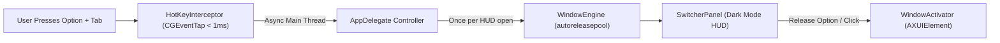

<div align="center">

# MacAltTab

**A native, crash-proof, 100% offline Windows-style `Option + Tab` (`Alt + Tab`) window switcher for macOS.**

[-000000?style=for-the-badge&logo=apple&logoColor=white)](https://github.com/ShaanAhamedM/MacAltTab)
[](https://swift.org)
[-2ea44f?style=for-the-badge)](Resources/MacAltTab.entitlements)
[-0969da?style=for-the-badge)](Package.swift)
[](Sources/MacAltTab/WindowEngine.swift)

</div>

---

## Why MacAltTab?

On macOS, `Command + Tab` switches between **applications**, not individual **windows**. If you have three VS Code windows, two Terminal windows, and two Chrome windows open, macOS forces you to remember different shortcuts (`Cmd + Tab` vs `Cmd + ~`).

**MacAltTab** (`MacAltTab.app`) brings true Windows-style `Option + Tab` (`Alt + Tab`) individual window switching to macOS—engineered from the ground up with **strict systems-engineering and security guardrails** so it never freezes `WindowServer`, never leaks memory, and never connects to the internet.

---

## Key Features

- **Individual Window Switching (`Option + Tab`):** Switch directly between every open window across all applications—including multiple windows of the exact same app (e.g., 3 separate VS Code or Terminal windows).
- **Floating Dark-Mode HUD (`NSPanel`):** Clean, native `.hudWindow` blur overlay with live window thumbnails (or app icons), window titles, keyboard cycling, arrow-key navigation, and mouse click/hover support.
- **100% Offline & Zero Dependencies:** Built exclusively with Apple system frameworks (`AppKit`, `CoreGraphics`, `ApplicationServices`, `Foundation`, `Carbon`). Zero Swift Package Manager dependencies, zero CocoaPods, and zero network entitlements.
- **Ultra-Low Memory Footprint (~11 MB RAM):** Every window discovery query and thumbnail capture (`max 320x200`) runs inside strict `autoreleasepool` blocks once per switcher session and is freed immediately when the HUD closes.
- **Sub-Millisecond Event Tap + Hardware Panic Switch:** Non-blocking `CGEventTap` callback with automatic watchdog recovery and an instant hardware-level `Control + Option + Escape` emergency killswitch.
- **Launch at Login Toggle:** Built-in Menu Bar toggle (`Launch at Login`) backed by a clean per-user LaunchAgent (`KeepAlive = false`, so quitting or triggering the panic killswitch always stays quit).

---

## Security & Stability Architecture

Because window switchers require macOS **Accessibility** (and optionally **Screen Recording**) permissions, **MacAltTab** is designed to be completely auditable in under 5 minutes (~800 lines of pure Swift across 7 files):



### 1. Zero Network & Anti-Injection Lockdown
- **No Networking Code:** Zero `URLSession`, `Network`, sockets, HTTP, or WebSocket calls exist anywhere in the repository.
- **Hardened Entitlements ([`Resources/MacAltTab.entitlements`](Resources/MacAltTab.entitlements)):** Explicitly sets `com.apple.security.network.client = false` and `com.apple.security.network.server = false`.
- **Startup Security Audit ([`SecurityAudit.swift`](Sources/MacAltTab/SecurityAudit.swift)):** Verifies at startup that no dynamic library injection variables (`DYLD_INSERT_LIBRARIES`, `DYLD_FORCE_FLAT_NAMESPACE`, etc.) are attached to the process, refusing to launch if tampering is detected, and strips any proxy environment variables.

### 2. Crash-Proof `CGEventTap` ([`HotKeyInterceptor.swift`](Sources/MacAltTab/HotKeyInterceptor.swift))
- **Rule #1 (`< 1ms` Callback):** Never queries window lists, captures screenshots, or touches AppKit UI synchronously inside the event tap callback. All UI work is dispatched asynchronously to `DispatchQueue.main.async`.
- **Watchdog Recovery:** Automatically intercepts `.tapDisabledByTimeout` and `.tapDisabledByUserInput` and immediately re-enables the tap so macOS never drops shortcuts.
- **Fast-Tap Race Guard:** Detects if you tap and release `Option + Tab` in under 20ms and switches immediately without leaving the HUD stuck on screen.
- **Emergency Killswitch (`Ctrl + Opt + Esc`):** Pressing `Control + Option + Escape` inside the event tap immediately disables the tap and terminates the process.

### 3. Zero Memory Leaks ([`WindowEngine.swift`](Sources/MacAltTab/WindowEngine.swift))
- Wraps every call to `CGWindowListCopyWindowInfo` and `CGWindowListCreateImage` inside nested `autoreleasepool { ... }` blocks.
- Captures thumbnails **only once** when the HUD opens—holding `Option` and pressing `Tab` repeatedly only moves the selection highlight in memory.
- Downscales thumbnails to a maximum of `320x200` pixels and releases all image buffers the instant the HUD closes.

---

## Quick Start (Build from Source)

### Prerequisites
- macOS 13.0 (Ventura) or later (Apple Silicon `arm64`)
- Xcode Command Line Tools (`xcode-select --install`)

### Build & Run
Clone the repository and run the automated build, self-test, and app-bundling script:

```bash
git clone https://github.com/ShaanAhamedM/MacAltTab.git
cd MacAltTab
bash scripts/bundle_app.sh
open MacAltTab.app
```

What `scripts/bundle_app.sh` does:
1. Compiles a release `arm64` binary with `swift build -c release`.
2. Runs the built-in `--self-test` suite (verifies the anti-injection audit and runs 100 consecutive window discovery cycles to ensure flat RAM usage under 35 MB).
3. Packages `MacAltTab.app` with [`Resources/Info.plist`](Resources/Info.plist) (`LSUIElement = true` so it lives cleanly in your Menu Bar).
4. Signs the bundle locally with hardened offline entitlements ([`Resources/MacAltTab.entitlements`](Resources/MacAltTab.entitlements)).

---

## Keyboard Shortcuts & Controls

| Shortcut / Action | Description |
| :--- | :--- |
| <kbd>Option</kbd> + <kbd>Tab</kbd> | Open the switcher HUD and cycle **forward** through open windows |
| <kbd>Option</kbd> + <kbd>Shift</kbd> + <kbd>Tab</kbd> | Cycle **backward** through open windows |
| **Release** <kbd>Option</kbd> | Activate the highlighted window and bring that exact window to the front |
| <kbd>←</kbd> / <kbd>→</kbd> **Arrow Keys** | Navigate left or right while the switcher HUD is open |
| <kbd>Return</kbd> / **Mouse Click** | Immediately switch to the selected/clicked window |
| <kbd>Escape</kbd> *(while HUD is open)* | Cancel switching and close the HUD without changing focus |
| <kbd>Control</kbd> + <kbd>Option</kbd> + <kbd>Escape</kbd> | **Emergency Panic Killswitch:** Immediately disables the keyboard tap and quits MacAltTab |

---

## Permissions Explained

When you first launch `MacAltTab.app`, a clean **Permissions Setup** window appears if Accessibility is not yet enabled:

1. **Accessibility (Required):**
   - **Why:** Required by macOS to listen for the `Option + Tab` shortcut and raise the specific window you select to the front (`AXUIElement`).
   - **Where:** `System Settings -> Privacy & Security -> Accessibility`
2. **Screen Recording (Optional — For Live Thumbnails):**
   - **Why:** Used locally in memory (`CGWindowListCreateImage`) to display miniature `320x200` window previews inside the `Option + Tab` HUD.
   - **Don't want to grant Screen Recording?** No problem! **MacAltTab works without Screen Recording permission**—it automatically falls back to displaying high-resolution **Application Icons** and reads window titles via the Accessibility API instead.

---

## Project Structure

```text
MacAltTab/
├── Package.swift                        # Swift Package Manager manifest (macOS 13+, zero dependencies)
├── Resources/
│   ├── Info.plist                       # Menu Bar utility config (LSUIElement) & privacy strings
│   └── MacAltTab.entitlements           # Explicit anti-network & anti-DYLD-injection entitlements
├── Sources/MacAltTab/
│   ├── main.swift                       # Startup security audit, --self-test runner, and app entry
│   ├── SecurityAudit.swift              # Blocks DYLD_INSERT_LIBRARIES & strips proxy env vars
│   ├── PermissionManager.swift          # Non-spamming Accessibility & Screen Recording onboarding UI
│   ├── WindowEngine.swift               # Memory-safe window discovery & 320x200 thumbnail engine
│   ├── HotKeyInterceptor.swift          # <1ms CGEventTap listener, watchdog & Ctrl+Opt+Esc killswitch
│   ├── SwitcherPanel.swift              # Floating dark-mode NSPanel HUD with keyboard & mouse support
│   ├── WindowActivator.swift            # Exact multi-window focus engine using AXUIElement
│   ├── LaunchAtLoginManager.swift       # Clean per-user LaunchAgent manager for Launch at Login
│   └── AppDelegate.swift                # Menu Bar controller & switcher state coordinator
└── scripts/
    └── bundle_app.sh                    # Release compiler, 100x memory test runner & .app bundler
```

---

## License

Released under the [MIT License](https://opensource.org/licenses/MIT).
